I work where systems stop agreeing with each other.

Two platforms. Different assumptions. Different APIs. Probably different decades.
Someone still has to make them talk.

That's usually me.

I build **backends, integrations, automation, and infrastructure** — mostly the parts users never notice until they stop working.

I like software that survives more than the happy path: bad data, weird users, legacy systems, production traffic, Monday mornings.

---

## `what_i_do()`

At Sorgetech, I work on enterprise software for manufacturing, retail and public-sector clients.
Alongside work, I study Electronic and Computer Engineering at the University of Ferrara.

**Backend engineering**
Java, Spring Boot, Jakarta EE, Tomcat. Multi-tenant portals, dashboards, production scheduling, authentication, authorization, RBAC, APIs and business logic that inevitably becomes more complicated than the diagram suggested.

**Systems integration**
Connecting platforms that were absolutely not designed with each other in mind. REST APIs, enterprise software, custom services, data synchronization and automation.

**ITSM**
Extending and integrating SysAid: custom reporting, workflows, APIs and tooling around real operational processes.

**SQL performance**
MySQL and SQL Server, including hierarchical datasets and query optimization. On one management report, restructuring the filters brought execution time from several minutes down to a few seconds.

**Applied AI**
NLP pipelines for personal data anonymization in Italian, MCP servers and LLM-powered automation integrated into enterprise software.

> Repetitive task? Automate when it saves more work than it creates.
> Fragile system? Understand the constraints before changing it.
> Query takes three business days? Find out why, then fix the bottleneck.

---

## `selected_projects()`

The code projects below form my learning archive: school assignments and personal experiments, each with its own purpose and constraints. I keep them for reference, without active development or maintenance. My current professional focus is described above.

A short selection before the full timeline:

- [**ReviewHub API**](https://github.com/anItalianGeek/reviewhub_restAPI) — High-school tutoring backend in Java & Spring Boot with MariaDB; deployed exclusively within the school environment on a Raspberry Pi with TLS and systemd during the school project.
- [**PostItter**](https://github.com/anItalianGeek/PostItter) & [**PostItter API**](https://github.com/anItalianGeek/PostItter_RESTfulAPI) — Real-time social prototype built for a personal 3-month challenge following my Vienna internship (Angular SPA, ASP.NET Core backend with custom signed session tokens, and SignalR hubs).
- [**mazeSolver-multiThread**](https://github.com/anItalianGeek/mazeSolver-multiThread) — Concurrent maze exploration in Java: an experiment with threads, semaphores, and live Swing rendering.
- [**huffman-simple**](https://github.com/anItalianGeek/huffman-simple) — Educational Huffman encoder/decoder written in 8086 Assembly, with compile-time frequencies, a fixed 6-character alphabet, and explicit absence of bit packing.
- [**jpictureslot**](https://github.com/anItalianGeek/jpictureslot) — Lightweight Java Swing image display component providing C#-style picture-box scaling modes, reused across subsequent desktop projects.

---

## `git log --oneline`

Most of this profile is chronological.

Every project is basically something I had just learned, pushed slightly further than was reasonable.

Looking back, there's also a recurring pattern:
**solve a problem → learn something new → solve the same class of problem again under worse constraints.**

Apparently that's how I learn.

### 2023 — loops, arrays, stubbornness

No OOP yet. No data structures course. Just enough knowledge to become dangerous.

* [**huffman-simple**](https://github.com/anItalianGeek/huffman-simple)
  Huffman coding in **8086 assembly**: tree construction, code table generation, encoding and decoding for a fixed 6-character alphabet with compile-time frequencies (no bit packing: 1 byte per bit).

  I had already implemented it in C# for an assignment. Then I rewrote it in assembly for the highly scientific reason of *“I wonder if I can.”*

* [**maze-solver**](https://github.com/anItalianGeek/maze-solver)
  Backtracking maze solver in C#, using an explicit crossroad stack instead of recursion.

---

### 2024 — objects, networks, threads

Turns out adding abstractions creates entirely new ways to make bugs.

* [**jpictureslot**](https://github.com/anItalianGeek/jpictureslot)
  Java Swing didn't have the equivalent of C#'s `PictureBox`, so I built one.

  Five display modes, automatic resizing, drop-in usage. I kept reusing it in later projects, making it probably the most accidentally useful repository on this profile.

* [**network-chef**](https://github.com/anItalianGeek/network-chef)
  Subnetting calculator built to answer two questions:

  1. How much of my networking coursework could I turn into actual software?
  2. How fast could I make it?

  Nobody asked me to build this one.

* [**mazeSolver-multiThread**](https://github.com/anItalianGeek/mazeSolver-multiThread)
  Same maze problem as the year before.

  This time: concurrent `PathFinder` threads, semaphore synchronization and a Swing visualization of the search happening in real time.

  Same problem. Harder constraint.

---

### Summer 2024 — browser acquired

I spent a month interning at **CS nine Business Solutions in Vienna** (June 2024).

After the internship, I worked on the three-month personal challenge they'd set me:

> Build a functioning social platform.
> Three months.
> Whatever state it's in when the clock runs out.

So I did.

* [**PostItter**](https://github.com/anItalianGeek/PostItter)
  Angular frontend with timeline, search, notifications and real-time chat.

* [**PostItter API**](https://github.com/anItalianGeek/PostItter_RESTfulAPI)
  ASP.NET Core backend with custom signed session tokens and SignalR hubs.

This was the point where software stopped feeling like isolated exercises and started feeling like systems.

---

### 2024/25 — works on my machine wasn't enough anymore

A school assignment became the largest project I'd built up to that point.

Then my teachers had me deploy it exclusively within the school environment:

Raspberry Pi.
School domain.
TLS.
Database.
Linux services.
Automatic recovery after reboot.

Suddenly `localhost` wasn't a deployment strategy.

That was the school deployment from this part of the story.

* [**ReviewHub API**](https://github.com/anItalianGeek/reviewhub_restAPI)
  Spring Boot backend with JPA persistence on MariaDB and JWT authentication, deployed exclusively at school during the project. The implementation and its authorization limits are described in its README.

* [**ReviewHub**](https://github.com/anItalianGeek/reviewhub)
  Angular frontend for bookings, rooms, subjects and administration.

* [**digitML**](https://github.com/anItalianGeek/digitML)
  School group project for open-day demonstrations of handwritten digit and letter recognition. My listed role was **Project manager**; the README credits the teammates responsible for the ML model, API, web app, and Android client.

---

### July 2025 — Sorgetech

Then the context shifted from classroom assignments to enterprise systems.

Production databases, multi-platform integrations, legacy constraints, real users, and real operational consequences.

Most of what I work on today lives in the section at the top of this page.

The archived repositories on this profile are where I learned how to get here.

---

## `stack`

| Context | Technologies |
| ---------------------------------- | ------------------------------------------------------------------ |
| **Current work focus**             | Java · Spring Boot · Jakarta EE · Tomcat · MySQL · SQL Server · REST & SysAid integrations |
| **Visible in public projects**     | C# / ASP.NET Core · Angular · TypeScript · JavaScript · MariaDB · Java Swing · 8086 assembly |
| **Other tools & interests**        | Docker · Linux · Apache · MongoDB · Python · PHP · C · Git · HTML / CSS · Arduino / ESP32 |

---

## `ping ognjen`

[**LinkedIn**](https://www.linkedin.com/in/ognjen-vasic-1b405a41b/) · **[ognjenvasic70@gmail.com](mailto:ognjenvasic70@gmail.com)**

Based in **Veneto, Italy 🇮🇹**

Yes, the GitHub handle is exactly as literal as it sounds.  
Today's workaround is tomorrow's critical infrastructure.
